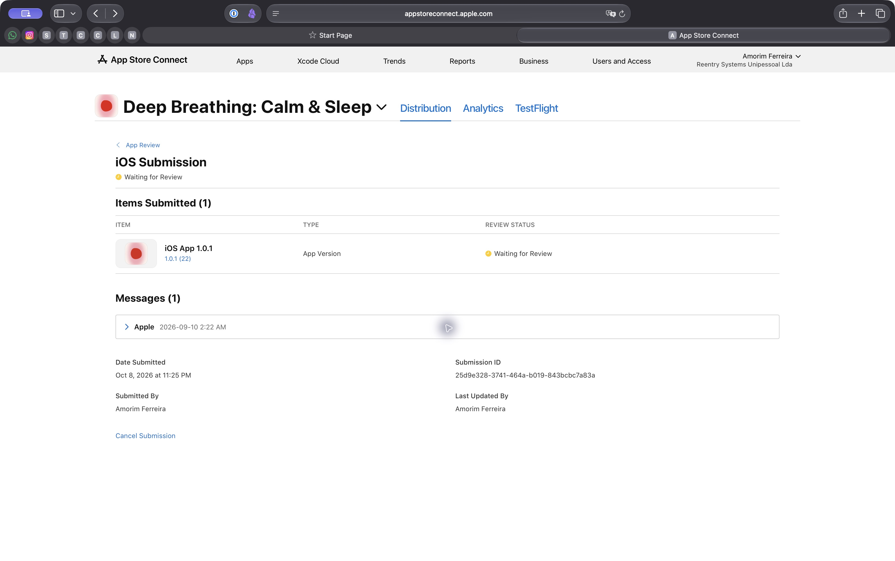

# iOS 1.0.1 privacy correction

Apple rejected build 21 on September 10, 2026 under Guideline 5.1.2(i).
Submission ID: `25d9e328-3741-464a-b019-843bcbc7a83a`.

## Target

- App: Deep Breathing: Calm & Sleep
- App Store Connect app: `6786431781`
- Bundle: `com.deepbreathing.app`
- Apple team today: `7ZCKCVM4C5`, Amorim Ferreira (Individual).
- Apple team for this record: `M29XZH5LMJ`, Reentry Systems Unipessoal Lda. That team
  owned the app and signed builds through 1.0.1 (22). The app moved to the Individual
  team in early November 2026. See [team-transfer-1.0.2.md](team-transfer-1.0.2.md).
- Expo owner: `abiabiassi`
- Expo project: `c5bbb03a-2e8d-44fd-90a6-fe6ab08197a4`
- Source checkout: `/Users/abi/work/deepbreathing-ios-no-tracking`
- Branch: `fix/ios-remove-tracking`
- Base: `4dd1c69b29f20dc510e17b362f4bcec101ac7549`

## Correction

Metro resolves `ga4-mp.ios.ts` for iOS. That module has no analytics endpoint,
identifier creation, or network transport. It deletes the previous analytics
identifier and saved consent. The host does not display the custom analytics
prompt or the control that reopens it. Web and Android analytics stay unchanged.

Guest practice and settings remain local. Optional sign-in and practice sync
still collect account data for app functionality. The app does not use IDFA,
advertising attribution, or tracking across other companies' apps and websites.

## Candidate iOS App Privacy answers

Data collection remains **Yes** because of optional accounts and practice sync.
Tracking remains **No**. At manual release, remove the per-install analytics
Device ID declaration and remove Analytics from Product Interaction's purposes.

| Data type | Collection | Linked to user | Tracking | Purpose |
|---|---|---|---|---|
| User ID | Optional accounts | Yes | No | App Functionality |
| Email Address | Optional accounts | Yes | No | App Functionality |
| Name | Optional account provider supplies it | Yes | No | App Functionality |
| Product Interaction | Signed-in practice sync | Yes | No | App Functionality |

Apple publishes App Privacy changes immediately. Its instructions require answers
to describe the version currently available on the App Store. Version 1.0 remains
available while 1.0.1 waits for review and manual release. Retain its Device ID
and Analytics disclosures until that release. User ID was added for optional
accounts, with App Functionality, linked to the user, and tracking set to No.
See [Apple's App Privacy instructions](https://developer.apple.com/help/app-store-connect/manage-app-information/manage-app-privacy).

The new iOS policy is `public/ios-privacy.html`, linked from the iOS account sheet.
It is live at `https://deepbreathingexercises.com/ios-privacy.html` and explicitly
applies to 1.0.1 and later. The listing and Review Notes link to that page.
At manual release, also set the global App Store Connect Privacy Policy URL to
that address. Until then, its existing `/privacy` URL remains unchanged.

The owner authorized publication of the prepared policy through GitHub main on
October 8, 2026. Preserve the Git integration production provenance guard.

## Review Notes draft

Use this text only after the exact candidate has passed verification:

> This update removes usage analytics and the custom analytics permission prompt
> from the iOS app. The iOS app no longer creates or sends analytics identifiers
> or usage analytics events, including for users who previously opted in.
> Existing local analytics identifiers and preferences are deleted on launch.
> The app does not track users across other companies' apps or websites and does
> not use the advertising identifier. No tracking permission request is present.
> Optional Apple and Google sign-in remain available solely for account access
> and practice sync. Guest breathing, local stats, audio, and haptics work without
> sign-in. The UI is bundled locally and rendered in an Expo DOM web view.

## Release record

- Source commit: `b5be1d1cc7abf656a0190c2b8c4ef3eeb301a4eb`
- Automated checks: 124 mobile tests and 463 root tests passed; 7 root tests
  skipped. Mobile typecheck/lint, Expo Doctor 21/21, release hygiene, critical
  dependency audit, Next.js production build, and post-build checks passed.
- iOS export: the source map includes only `ga4-mp.ios.ts`; it has no analytics
  endpoint, network transport, or analytics ID creation.
- Simulator Release build: succeeded with Xcode 27.0 and deployment target 16.4.
  Bundle version 1.0.1, local build number 1. This is not the signed store binary.
- Initial local Xcode 27 launch failed. SDK 56's generated native
  template lacks UIKit scene lifecycle support required by the iOS 27 SDK.
  That local artifact stopped before JavaScript ran. The cloud Xcode 26.4
  artifact below resolves the launch failure. See [Expo issue 46664](https://github.com/expo/expo/issues/46664)
  and [Apple's lifecycle requirement](https://developer.apple.com/documentation/uikit/transitioning-to-the-uikit-scene-based-life-cycle).
- Simulator artifact: `/tmp/deepbreathing-ios-native-review/Build/Products/Release-iphonesimulator/DeepBreathing.app`
- Simulator main bundle SHA-256: `33b81ccc39e9e213d6abf4b27dfcce2c6c9cfed6302fddb62407e2863d65718f`
- Policy rendered locally and inspected; publication verified on production.
- EAS simulator and production profiles use `macos-tahoe-26.4-xcode-26.4`, the
  [documented SDK 56 image](https://docs.expo.dev/build-reference/infrastructure/#macos-tahoe-264-xcode-264-sdk-56).
  After Expo login, build the simulator profile for native UI and upgrade checks
  before creating the production candidate. Simulator build `ca591359-9140-4bf7-ad5f-7cb691e6b8b0` finished from
  `ffb20e4f7b306b273bc2c8b8a465bd428f8d16e4`, version 1.0.1 (21).
  The simulator build does not increment the production version.
- Production EAS build: `65f7283f-9549-4afe-af84-137fc29935b2`, version 1.0.1 (22).
- Production source: `14f6e08fcdc1b05299c226101ffd297550d19d92`.
- Signed IPA SHA-256: `c66bdf2c9b694d1b821ea0539f00b1795554eeb9d540052e39980cd58a8201ab`.
- Inspected the signed IPA: correct bundle, version, build and team; tracking
  false, no Device ID collection, and no analytics endpoint in packaged code.
- EAS upload: `28ee27a2-c92d-436a-b6e5-b7cedd57b60e`, Succeeded.
- Apple processing finished; selected build 22 and saved the version.
- App Privacy readback: User ID added and published. Existing live 1.0 analytics
  disclosures remain until manual release, as described above.
- Review Notes saved, including the analytics removal and privacy-label timing.
- Resubmission: **Waiting for Review**, October 8, 2026 at 11:25 PM, as displayed
  by App Store Connect. Submission ID remains `25d9e328-3741-464a-b019-843bcbc7a83a`.
- Release timing: preserve the existing manual release setting
- PR [#80](https://github.com/Darkmatter-AI/deepbreathing/pull/80) merged to main
  `a78763e9cf6a2aec5803b5d03f6d772f087ae75a`. Its tree equals the production source.
- Vercel Git production deployment: `dpl_tVfzUsEwXr8KWjhtM8t9bvz3pP7e`.
  Build logs confirm the production source guard passed for that main commit.
- Public iOS policy returned HTTP 200 and matches the deployed main source.

## Access and cleanup

Expo login is verified as `abiabiassi`. Safari is authenticated in App Store
Connect as Amorim Ferreira, Reentry Systems Unipessoal Lda, the owning team on
October 8, 2026. Live readback confirms
app 6786431781, version 1.0.1 with build 22 Waiting for Review, and manual release.
The requested App Store Connect tab remains open in Safari. Agent-created
verification browser tabs are closed. The DBE Privacy Review simulator is shut
down and removed from the Device panel. No agent-started server is running.

## Listing corrections prepared for submission

Replace the English PRIVACY paragraph with:

> The iOS app does not collect usage analytics or track you across other companies’
> apps and websites. The app works without an account. Optional Apple or Google
> sign-in syncs practice sessions and settings. See our iOS Privacy Policy at
> deepbreathingexercises.com/ios-privacy.html.

Add to What’s New and remove the old statement about analytics choices:

> Usage analytics and the analytics permission prompt have been removed from the
> iOS app. Optional accounts still let you sync your breathing practice.

Review each saved localization for equivalent stale analytics wording before
submission. Do not change unrelated listing copy.

Policy review evidence, rendered locally and inspected:

## Cloud simulator verification

- Artifact: `/tmp/deepbreathing-cloud-simulator-20261008/DeepBreathing.app`
- Compiled with Xcode 26.4.1, SDK iphonesimulator26.4.
- Artifact bundle: com.deepbreathing.app, version 1.0.1, simulator build 1. EAS
  reports remote build metadata 21; this is not a production upload candidate.
- Main bundle SHA-256: `1376e3872ee21e390142c3f0e68471b6934ae663271c6d376cbbb3d7246048b6`.
- Launched on iPhone 17 Pro Max, iOS 27.0, in the T3 Device panel.
- Seeded the existing app container with the old analytics identifier and
  granted consent. Both keys were absent after launching the corrected app.
- Home and Account were exercised and inspected. No custom analytics prompt
  or analytics consent control appeared. Optional Apple and Google buttons and
  the Privacy Policy link remain available. Authentication was not exercised.

- Clean installation also opens Home without an analytics prompt.
- A 30-second guest session completed and displayed its local completion summary.
- No physical iPhone, speaker/audio, haptic, or signed-in sync check was performed.
  The Build 18 checklist is historical; live ASC confirms that version 1.0 is
  already Ready for Distribution and version 1.0.1 (21) is the rejected update.
  This correction does not change audio, haptic, or authentication implementation.

