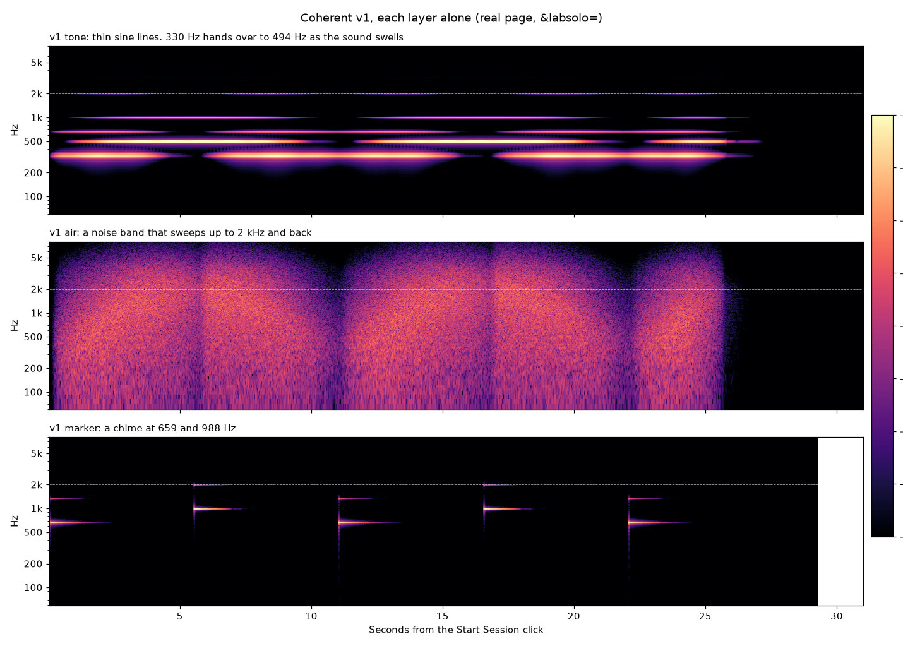
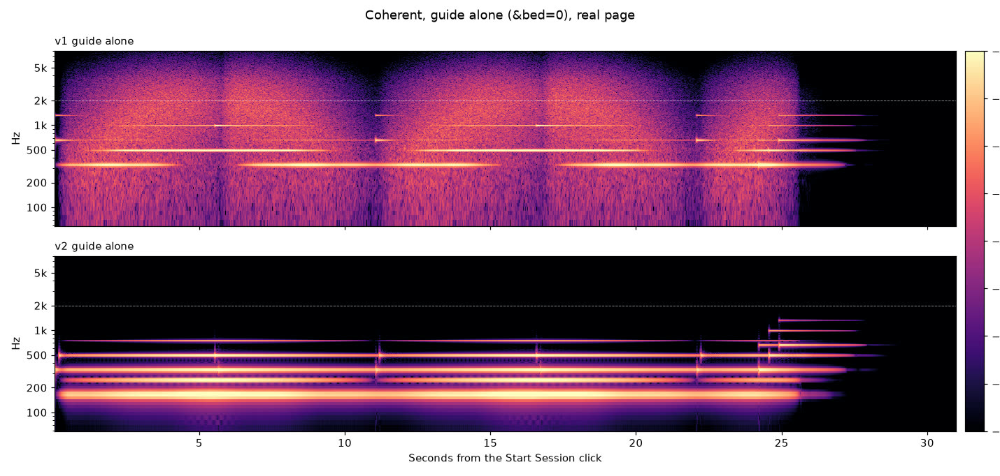
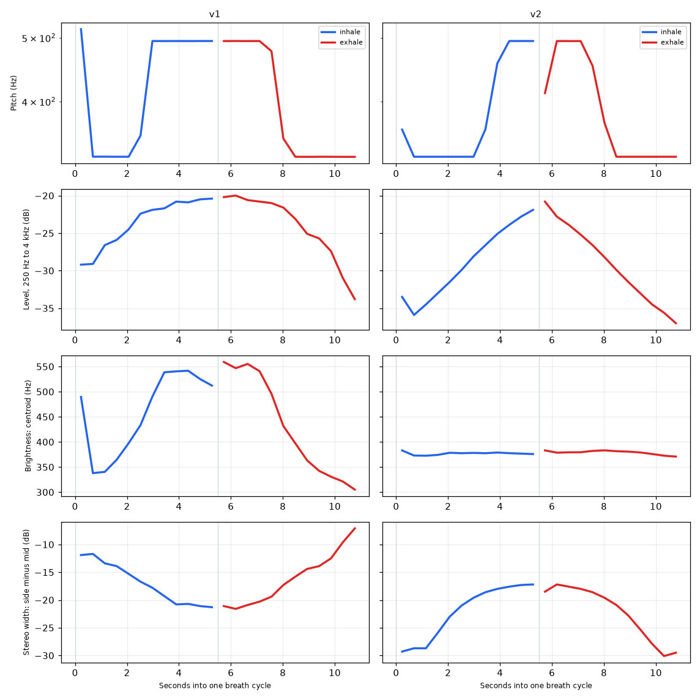

# Sound design, November 2026: the sound guide

Status: prototype on branch `t3/eyes-closed-sound-design`, web only, behind `?sound=guide`. Default off. Not shipped. Second version (v2), after the first listening pass on 2026-11-14.

## Summary

Today a session marks each phase with a 0.3 s blip at its start. Between two blips the sound does not change. A person with closed eyes cannot tell an inhale from an exhale, or how much of the phase is left. A customer asked for exactly this by support mail on 2026-10-24: an inhale and exhale tone in Coherent Breathing, so that watching the screen is not needed.

The proposal is one new layer, the **sound guide**: a low, warm voice that plays for the whole phase and fills and empties the way the lungs do. It gets louder, rounder and wider on the inhale. It stands still on a hold. It is the inhale played backwards on the exhale. It is synthesized in the shared engine (`packages/audio`), so the same code can run on iOS. It uses no audio files and no paid service.

The first version (v1) was heard as "a mosquito" and "a zoom that's growing". [What the first listening pass found](#what-the-first-listening-pass-found) names the cause and the change. The closing chord, which the listener liked, is unchanged.

Try it: open `/breathe/coherent?sound=guide` on the branch. Add `&bed=0` to hear the guide without the ambient bed.

## What exists

Web and iOS share one engine, `packages/audio/src/audioService.ts`. The web app drives it from `src/components/resonance/Resonance.tsx`. The iOS app runs the same engine on `react-native-audio-api` through `apps/mobile/src/breathing/native-soundscape.ts`; the webview stays the timing authority and sends `phase_haptic`, `audio_state` and completion events to the native shell.

| Moment | What plays today |
|---|---|
| Session start | Beds fade in over 2 to 3 s. The first inhale cue plays. No start sound. |
| Inhale | A 0.24 to 0.38 s cue: a tone that glides up (Box 520 to 660 Hz) plus a noise puff. |
| Second inhale (Physiological Sigh) | The same inhale cue again. |
| Hold, full or empty | A 0.22 to 0.26 s flat tone. Both holds use the same cue. |
| Exhale | A 0.30 to 0.42 s cue: a tone that glides down plus a noise puff. |
| Between cues | Drone modes: nothing that follows the breath. 4-7-8 and Coherent: the noise bed's filter opens and closes (480 to 2400 Hz). |
| Session end, web | Beds fade out over 1 to 1.5 s. No completion sound. |
| Session end, iOS | The same fade, then a two-note completion bloom (`playCompletionCue`). |
| Beds | Box, Sigh, Ujjayi, Belly, Pursed Lip: a four-partial drone that orbits the listener, a sub-bass and a 10 Hz binaural pair. 4-7-8 and Coherent: pink noise, a sub-bass and a binaural pair (2 Hz and 10 Hz). |
| Cue presets | Box, 4-7-8 and Coherent have their own. Sigh, Ujjayi, Belly and Pursed Lip share one default set. |

Settings and platform behaviour:

- **Mute.** Settings has one "Sound on / Sound off" button. It ramps the master gain to 0 in 0.1 s. The choice is not saved. iOS mirrors it through `audio_state.muted`.
- **Volume.** There is no user control. The engine uses fixed defaults (cue 0.32, music 0.3).
- **Binaural beats.** A Settings switch, on by default, saved, and mirrored to iOS.
- **Eyes closed.** `?eyesClosed=1` dims the visuals and adds one sine tone that swells on the inhale and decays on the exhale. The Settings switch is parked: a code comment says the feature needs voice narration in each locale to be useful.
- **iOS app.** The audio session category is `playback`. Sound plays with the ringer switch off and continues on the lock screen. The native chain has no compressor (a soft clipper stands in) and no 3D panner (a stereo panner stands in).
- **iOS Safari.** Web Audio follows the ringer switch, so a silenced phone plays nothing. The web app shows a hint for this.

## What is wrong with it

Measured on `main` at `9339d55` with `scripts/audio-lab` (real engine, real page, headless Chromium).

1. **A phase is marked only at its start.** A Coherent phase lasts 5.5 s; its cue lasts 0.34 s. In the drone modes nothing follows the breath for the rest of the phase. In Coherent and 4-7-8 only the noise bed's filter does, and that bed is the quietest layer: the level moves by 1.7 dB across an inhale.
2. **Inhale and exhale are nearly the same cue.** In Coherent both start at 294 Hz. One glides up two semitones, the other down two semitones, in a third of a second.
3. **Holds and the double inhale are not told apart.** A full-lungs hold and an empty-lungs hold play the same cue. The two inhales of the Physiological Sigh play the same cue.
4. **Loudness jumps 10 dB between modes.** Box measures -15.3 LUFS and Sigh -15.0 LUFS. Coherent measures -25.7 LUFS.
5. **The loudest steady sound in Coherent is the binaural carrier.** The fixed 200 Hz pair measures -29 dBFS. The noise bed, the one layer that follows the breath, measures -43 dBFS. The carrier is also out of key: Box's drone has a partial at 196.2 Hz, 3.8 Hz below it.
6. **Cues are not in the drone's key.** Cue pitches are fixed in Hz. The drone root moves with the mode, and the session arc lowers it by a whole tone over four minutes. The engine's own comments note this.
7. **Every session ends on a hard cut.** The sub-bass has an LFO that adds to its gain. The fade ramps the gain to 0, but the LFO swing keeps sounding until the oscillator stops. The result is a step of -53 to -66 dBFS into silence, about 1.6 s after each stop. It appears in five of the six baseline recordings. The step is small and may be inaudible on its own. The drone is built the same way; its stop sits behind a lowpass, so the tooling cannot measure it.
8. **The web app has no start or completion sound.** The completion bloom exists, but only iOS calls it.
9. **Mute is not saved, and there is no volume control.**

One item outside sound: CI does not run `packages/audio/src/audioService.test.ts`. The mobile job runs vitest inside `apps/mobile` only.

## Lessons from the earlier work

- **Audio V2** (`audio-v2-overnight`, merged through PR #21) added texture: the sub-bass, the breathing noise bed and the session arc. Texture made the sound richer. It did not make a phase easier to read. Its hiss came from triangle harmonics and the 3D panner, and a drone lowpass fixed it. The lesson: keep every new layer below about 3 kHz and measure the top band.
- **DAR-379** (`abi/dar-379-audio-eyes-closed-audio-only-mode`, one unmerged commit) joined two things: a dimmed screen and one swelling sine. The sine freezes during holds and has no edges, so it cannot say "hold" or "now". The feature was parked for narration, which costs a recording per locale. The lesson: make the sound readable without words, and keep it separate from any change to the visuals.
- **react-native-audio-api** renders repeated `setTargetAtTime` calls as an audible warble (recorded in the engine on 2026-07-22). The lesson: schedule each phase once, with linear ramps only.
- **The V2 experiment entry** named three metrics and never reached a verdict. The lesson: one primary metric.

## What the first listening pass found

Abi listened to v1 (commit `d615bb9`) and reported two things:

1. "Some of the sounds aren't really filling up, and they seem to always be on the same trajectory, so it's confusing in audio."
2. "It sounds like a mosquito, like a zoom that's growing. I like the shine at the end. But there's a mosquito sound in there, and that's not great. Maybe it's the pitch. They all have the mosquito sound. Like the whoosh."

Each layer of v1 was then recorded alone from the real page (`&labsolo=<stem>`, see [`scripts/audio-lab/README.md`](../../scripts/audio-lab/README.md)) and measured for Coherent.

| v1 layer, alone | Level | Above 2 kHz | What it does through an inhale |
|---|---:|---:|---|
| **Tone** | -23.2 dBFS | -69 dBFS | One pure sine. 330 Hz hands over to 494 Hz while the level rises 8.4 dB. Nothing else sounds with it: the next partial is 20 dB lower. |
| **Air** | -38.1 dBFS | -44 dBFS | Band-passed noise. Its centre sweeps from 685 to 1,889 Hz (1.5 octaves) and back. |
| Marker | -40.9 dBFS | -91 dBFS | A chime at 659 Hz, then at 988 Hz on the exhale, 1.3 s long. |
| Noise bed | -40.8 dBFS | -57 dBFS | Its centre sweeps from 437 to 875 Hz (1 octave). The same bed plays on `main`. |
| Binaural pair | -39.3 dBFS | none | 247 and 257 Hz, one per ear. Summed to mono it beats at 10 Hz with a depth of 0.67. |
| Sub-bass | -40.2 dBFS | none | Steady. |

**The mosquito is the tone.** It is the loudest layer by 15 dB, it is a single sine with no body under it, it sits at 494 Hz when it is loudest, and it swells. `whine.py` adds up narrow peaks above 400 Hz with A-weighting: that number climbs from -44.5 to -23.0 dB across each inhale of the tone stem, and reads below -80 dB for the air and for every bed layer. All seven modes used the same tone, which fits "they all have the mosquito sound".

**The whoosh is the air layer.** It is the only layer with real energy above 2 kHz, and its band rises with the breath. In Coherent and 4-7-8 the noise bed sweeps under it as a second, quieter whoosh.

**One more candidate.** The binaural pair beats at 10 Hz when both carriers reach one ear, which happens on speakers. It is 16 dB quieter than the tone, and the same pair plays 7 dB louder on `main`. It is a flutter, not a whine. v2 moves it anyway (see below).

The earlier diagnosis of "the same trajectory" also holds in these clips. In v1 Box the level rose 3.0 dB on the inhale and fell 2.2 dB on the exhale, with the peak at 79 % of the inhale. In v1 Coherent the level sat within 1 dB of its top for the last third of the inhale and the first third of the exhale, so both phases were the same bump.

Stems to confirm by ear: [v1 tone](../evidence/sound-guide-2026-11-14/stems/coherent-v1-tone.m4a), [v1 air](../evidence/sound-guide-2026-11-14/stems/coherent-v1-air.m4a), [v1 marker](../evidence/sound-guide-2026-11-14/stems/coherent-v1-marker.m4a), and the [v2 tone](../evidence/sound-guide-2026-11-14/stems/coherent-v2-tone.m4a).

### What v2 changes

| | v1 | v2 |
|---|---|---|
| Register | Notes at 247 to 988 Hz | Notes one octave lower: root at 123 to 247 Hz |
| How it rises | The root fades out while the fifth fades in | The root always sounds; the fifth joins above it. Nothing replaces the root. |
| Timbre | Pure sine | Each note has two soft harmonics under a lowpass that opens from 420 to 1,150 Hz |
| Air | Noise, 450 to 1,900 Hz sweep, in every mode | None. Ujjayi alone keeps a faint band fixed at 420 Hz. |
| Noise bed (Coherent, 4-7-8) | Filter sweeps with the breath | Filter stays still under the guide |
| Inhale and exhale | Two bumps | Mirror images: the inhale peaks on its last moment, the exhale falls from its first |
| Hold | Slow sway | Still |
| Marker | One chime with a 1.3 s tail, at 494 to 1,976 Hz (659 and 988 Hz in Coherent) | Two short notes going up or down, or one bell on a hold, at 247 to 988 Hz (330 to 494 Hz in Coherent), 6 dB quieter |
| Binaural carrier | The fifth of the root (247 Hz for Coherent) | The fifth below the guide's root (124 Hz for Coherent) |
| Drone bed gain | ×0.22 | ×0.06 |
| Closing chord | Root, fifth, octave bells | The same notes at the same level |

Three things in v2 come from a patch that was written before the second remark arrived: the mirrored level curve (even in decibels, from a floor 15 dB under the peak), the still hold, and the two-note markers. The same patch also made the pitch glide a fifth through every inhale, opened the lowpass to 3 kHz and widened the air. Those parts were dropped: a tone that glides up while it swells is the "zoom".

## The proposal

### One grammar for every mode

The guide has two parts: a voice and a marker.

- **Voice.** Up to three notes of the mode's key: root, fifth and octave. The root sits at 123 to 247 Hz. Each note is a sine with two soft harmonics. A phone speaker does not play the root's fundamental; it plays the harmonics, at 247 to 741 Hz.
- **Marker.** Two short notes at the start of an inhale or an exhale, or one bell at the start of a hold, one octave above the voice.

| Phase | Voice | Level | Marker |
|---|---|---|---|
| Inhale | The fifth joins above the root; the lowpass opens | Rises for the whole phase, to its peak on the last moment | Two notes going up |
| Second inhale | The octave joins above the fifth | Short dip, then a second rise to the full peak | Two notes going up, one step higher |
| Hold, full | Stays as it is | Settles to about 70 %, then does not move | One bell |
| Exhale | The upper notes leave; the lowpass closes | Falls for the whole phase, from its first moment | Two notes going down |
| Hold, empty | The root alone | Near rest, does not move | One soft bell on the root |

A listener needs two rules. A sound that moves means breathe; a still sound means hold. Growing means in; shrinking means out.

Nothing glides and nothing sweeps. The pitch of every note is fixed. The only noise in the voice is Ujjayi's.

Session edges:

- **Start.** The beds fade in over 2 to 3 s and the voice over 0.5 s. The first marker starts the first inhale.
- **Completed session.** The voice fades over 1.6 s. A root, fifth and octave chord enters one note at a time and rings for about 4 s. The chord resolves; it is not a notification sound. It is the chord of v1, note for note.
- **Pause or stop.** The voice fades in 0.5 s. No chord plays.

### One articulation per mode

Every mode uses the same instrument. v1 gave each mode its own mix of tone and air. With the air gone, a mode differs by its key, by its phases and by a few values.

| Mode | Root of the voice | What changes |
|---|---|---|
| Box | C3, 131 Hz | Four equal sides: rise, still, fall, still. |
| 4-7-8 | D3, 147 Hz | A quieter 7 s hold (60 % in place of 72 %). |
| Coherent | E3, 165 Hz | No holds. One continuous wave. |
| Physiological Sigh | F3, 175 Hz | Two rises for the two inhales; the octave joins on the second. Then one long fall. |
| Ujjayi | C3, 131 Hz | The one mode with air: a faint band of noise fixed at 420 Hz, since the technique is a throat sound. |
| Belly | C3, 131 Hz | Darker: the lowpass opens to 850 Hz only. |
| Pursed Lip | E3, 165 Hz | Base profile. |

The tone gain differs by mode (0.145 to 0.19) only so that every mode lands at the same loudness. The other web modes use the base profile. Wim Hof keeps the legacy cues in this prototype, because its phases are not fixed in length.

### The ambient bed is optional and sits under the voice

With the guide on, the beds keep their per-mode recipe at a lower gain: drone ×0.06, sub-bass ×0.5, noise ×0.9, binaural ×0.45. The drone plays the same notes as the voice, and at ×0.22 its slow swells hid the voice's rise and fall. The noise bed's filter stays still. The binaural carrier moves to the fifth below the guide's root (92 to 185 Hz): it is in key, it is at least 30 Hz from every note of the voice and the drone, and it is below what a laptop or phone speaker plays. The drone holds its root while the guide plays. `&bed=0` removes the bed.

### Mute, volume and the silent switch

- The guide connects to the engine's master gain. Mute silences it the same way as every other layer, and unmute restores it at once.
- The guide scales with the engine's cue volume, so one future "guide volume" control needs no new audio code.
- On the iOS app the guide inherits the `playback` session: it plays with the ringer off and on the lock screen, like today's sound. That fits a session the user starts on purpose, and the in-app mute still works.
- On iOS Safari the ringer switch still silences everything. See the plan below.

## The prototype

| File | Role |
|---|---|
| `packages/audio/src/soundGuide.ts` | The guide. `planGuidePhase` is pure and holds the whole palette. `SoundGuide` schedules a plan on the audio clock. |
| `packages/audio/src/audioService.ts` | `startSoundGuide`, `playGuidePhase`, `stopSoundGuide`, the bed gains under the guide, the still noise bed, the in-key binaural carrier. |
| `src/components/resonance/Resonance.tsx` | Reads `?sound=guide` and `&bed=0`. Calls the guide at each phase start in place of `playCue`. |
| `scripts/audio-lab/` | Records and measures real sessions, whole or one layer at a time. |

Each phase is scheduled once, at its start, from its known length. Nothing runs per frame. The schedule uses `setValueAtTime` and `linearRampToValueAtTime` only. Each phase ends its curves 70 ms early and starts 30 ms ahead of the clock, so the next phase finds every parameter at rest.

A marker starts on the next moment when the voice oscillators are back at their starting phase, at most 16 ms later. A marker note has the pitch of a voice harmonic. Started in phase it adds to that harmonic; started anywhere else it could cancel it and sound as a dip.

Without `?sound=guide` no guide code runs. The session start and end events gain a `sound: "guide"` parameter only when the flag is on.

Four changes apply only under the guide, so production is unchanged: the LFO depth of the drone and the sub-bass fades with the bed (finding 7), the binaural carrier is in key (finding 5), the noise bed's filter stays still, and the bed gains are lower. The first two are worth applying to the legacy mix too. That needs Abi's decision.

## Evidence

All clips come from the real page and the real engine, in headless Chromium at 44.1 kHz. "Current" has no flag. "v1" is `?sound=guide` at commit `d615bb9`. "v2" is `?sound=guide` on this branch. Each clip starts at the Start Session click and runs past the session end.

| Where | What |
|---|---|
| [`docs/evidence/sound-guide-2026-11-14/`](../evidence/sound-guide-2026-11-14/) | Nine clips (current, v1, v2 for three modes), four stems, four sheets, and a screen recording of v1 with sound. |
| `/Users/abi/.t3/userdata/attachments/dbe-sound-2026-11-14-v2/` on the machine that ran this | v2 clips for all seven modes, every stem of v1 and v2, the sheets at full size, and a README. |

Listen in this order:

1. Coherent: [v1](../evidence/sound-guide-2026-11-14/coherent-v1.m4a), then [v2](../evidence/sound-guide-2026-11-14/coherent-proposed.m4a). [Current](../evidence/sound-guide-2026-11-14/coherent-current.m4a) for reference.
2. Box: [v1](../evidence/sound-guide-2026-11-14/box-v1.m4a), then [v2](../evidence/sound-guide-2026-11-14/box-proposed.m4a). [Current](../evidence/sound-guide-2026-11-14/box-current.m4a).
3. Physiological Sigh: [v1](../evidence/sound-guide-2026-11-14/sigh-v1.m4a), then [v2](../evidence/sound-guide-2026-11-14/sigh-proposed.m4a). [Current](../evidence/sound-guide-2026-11-14/sigh-current.m4a).
4. The stems, to confirm which v1 layer was the mosquito: [tone](../evidence/sound-guide-2026-11-14/stems/coherent-v1-tone.m4a), [air](../evidence/sound-guide-2026-11-14/stems/coherent-v1-air.m4a), [marker](../evidence/sound-guide-2026-11-14/stems/coherent-v1-marker.m4a).

The [screen recording](../evidence/sound-guide-2026-11-14/coherent-session-with-sound-v1.mp4) shows a v1 session. It was not recorded again for v2.

Both pictures use the same scales. The dashed line is 2 kHz. In v1 the haze that swells and reaches past 5 kHz is the air, the thin lines at 330 and 494 Hz are the tone, and the short marks at 659 and 988 Hz are the chimes. In v2 nothing reaches 1 kHz until the closing chord. The brightest row is the root at 165 Hz. The rows above it are the fifth at 247 Hz and the harmonics at 330 and 494 Hz, and all of them brighten and fade together. The short vertical marks are the markers. The chord at the right is the same in both. With the bed: [Coherent](../evidence/sound-guide-2026-11-14/coherent-v1-vs-v2.jpg).

Second row: the v1 level is a bump that stays near its top across the turn. The v2 level is a straight rise and a straight fall. Third row: v1 gets 200 Hz brighter and darker with each breath; v2 does not. The first row reads the strongest peak between 200 and 1,100 Hz. In v2 that reading moves between the 330 Hz and 494 Hz harmonics, which have nearly the same level; no note changes pitch. The Sigh: [contours](../evidence/sound-guide-2026-11-14/sigh-contours-v1-vs-v2.jpg).

### The mosquito and the whoosh, before and after

Coherent, guide alone (`&bed=0`), read between the start of the second inhale and the session end.

| | v1 | v2 |
|---|---:|---:|
| Strongest partial at the top of an inhale | 494 Hz at -15.4 dBFS | 165 Hz at -14.2 dBFS |
| Next partials | 989 Hz at -35.5 | 330 Hz at -20.9, 247 Hz at -21.3, 494 Hz at -21.6, 742 Hz at -32.9 |
| Narrow peaks above 400 Hz, A-weighted, at the top of an inhale (`whine_db`) | -23.4 dB | -30.0 dB |
| Level above 1 kHz | -39.6 dBFS | -116.1 dBFS |
| Level above 2 kHz | -44.0 dBFS | -130.7 dBFS |
| Spectral centroid through an inhale | 362 to 532 Hz | 246 to 259 Hz |
| Centroid sweep of the noise in the voice | 1.46 octaves | no noise |
| Centroid sweep of the noise bed | 1.00 octave | 0.01 octave |
| A-weighted level of the whole guide | -26.9 dB | -31.3 dB |
| Binaural pair, 10 Hz beat depth in the mono sum, 200 Hz to 3 kHz | 0.67 | 0.00 |

Two limits on this table. The 494 Hz partial is 6 dB lower in v2, not gone: it is now the third harmonic of a 165 Hz note. A version with half the harmonics read -35.3 dB on `whine_db`, but in the drone modes its rise and fall could no longer be read above 250 Hz (Box inhale +3.7 dB against +9.3 dB), so the fuller harmonics stayed. And the binaural pair still beats at 10 Hz in a mono sum; it now does so at 124 and 134 Hz, below the band this number reads and below what small speakers play.

### Measurements

| Clip | Length | Loudness | True peak | Clipped samples | Steps | 2 to 6 kHz | Inhale | Exhale |
|---|---:|---:|---:|---:|---:|---:|---:|---:|
| Coherent, current | 47 s | -25.7 LUFS | -10.5 dBTP | 0 | 1 | -54.7 dBFS | | |
| Coherent, v1 | 51 s | -20.1 LUFS | -11.3 dBTP | 0 | 0 | -42.9 dBFS | +7.7 dB | -10.5 dB |
| **Coherent, v2** | 51 s | -20.1 LUFS | -7.6 dBTP | 0 | 0 | -78.6 dBFS | +11.8 dB | -13.2 dB |
| Box, current | 47 s | -15.3 LUFS | -4.9 dBTP | 0 | 6 | -72.1 dBFS | | |
| Box, v1 | 55 s | -20.5 LUFS | -9.7 dBTP | 0 | 0 | -53.4 dBFS | +3.0 dB | -2.2 dB |
| **Box, v2** | 55 s | -19.5 LUFS | -7.4 dBTP | 0 | 0 | -83.0 dBFS | +9.3 dB | -7.7 dB |
| Physiological Sigh, current | 47 s | -14.9 LUFS | -4.9 dBTP | 0 | 4 | -70.8 dBFS | | |
| Physiological Sigh, v1 | 51 s | -19.8 LUFS | -9.4 dBTP | 0 | 0 | -43.2 dBFS | +5.4 and +3.5 dB | -9.6 dB |
| **Physiological Sigh, v2** | 51 s | -19.6 LUFS | -7.4 dBTP | 0 | 0 | -97.8 dBFS | +8.4 and +5.7 dB | -16.2 dB |
| 4-7-8, v2 | 64 s | -20.3 LUFS | -7.6 dBTP | 0 | 0 | -78.6 dBFS | +11.0 dB | -9.9 dB |
| Ujjayi, v2 | 37 s | -19.4 LUFS | -8.1 dBTP | 0 | 0 | -85.6 dBFS | +10.2 dB | -5.3 dB |
| Belly, v2 | 37 s | -19.1 LUFS | -7.7 dBTP | 0 | 0 | -82.8 dBFS | +8.5 dB | -11.3 dB |
| Pursed Lip, v2 | 37 s | -19.4 LUFS | -7.5 dBTP | 0 | 0 | -92.3 dBFS | +5.4 dB | -7.2 dB |
| Coherent, v2, no bed | 31 s | -20.8 LUFS | -8.2 dBTP | 0 | 0 | -128.7 dBFS | | |
| Box, v2, no bed | 39 s | -21.0 LUFS | -8.7 dBTP | 0 | 0 | | | |

How to read the table:

- **Loudness** is integrated EBU R128. The seven v2 modes span 1.2 LU (-20.3 to -19.1 LUFS). The three current modes span 10.8 LU.
- **Clipping.** No clip has a sample at full scale. The highest true peak in v2 is -7.4 dBTP.
- **Steps** are sharp discontinuities in the waveform. v1 and v2 have none. The current clips have the steps listed in "What is wrong with it". The detector was checked by injecting faults; see [`scripts/audio-lab/README.md`](../../scripts/audio-lab/README.md). It cannot see a tick that sits behind a lowpass.
- **2 to 6 kHz.** v2 is 36 dB under v1 in Coherent and 55 dB under v1 in the Sigh. What remains there in Coherent and 4-7-8 is the noise bed.
- **Inhale and Exhale** give the level in the last quarter of a phase minus the level in the first quarter, between 250 Hz and 4 kHz, averaged over whole cycles after the first (`contours.py`). The band is what a phone speaker plays. In all seven v2 modes the inhale rises and the exhale falls. In every v2 inhale the highest level is in the last twelfth of the phase, and in every v2 exhale it is in the first twelfth.
- **The inhale and the exhale are opposite shapes.** The correlation between the two level contours is -0.98 in Coherent, -0.95 in 4-7-8, -0.92 in the Sigh, and -0.74 to -0.86 in the four other modes. In v1 Box it was -0.43.
- **The Sigh reads as two fills.** The level rises 8.4 dB through the first inhale, dips 3.8 dB at the start of the second, and rises 9.6 dB from that dip to the peak.
- **Holds.** In the Box guide alone, both holds settle within the first second and then stay inside about 1 dB (the root's slow shimmer). With the bed, a hold moves by 4 to 6 dB overall, and by up to 10 dB in the band above 250 Hz during the empty hold. That is the drone's own slow swell. It is 11 dB quieter than in v1, but it is the only sound left there when the voice is near rest.

Checks beside the table:

- **The flag-off path is unchanged.** Clips without the flag were recorded in the same session from this branch and from `main` (the engine and the breathing component at `9339d55`; `main` has since changed only a click handler in that component). Coherent: -25.7 against -25.7 LUFS, true peak -10.5 against -10.5 dBTP. Box: -15.3 against -15.2 LUFS, -4.9 against -5.2 dBTP. Sigh: -14.9 against -15.1 LUFS, -4.9 against -4.0 dBTP. All five band levels agree within 0.3 dB in each pair. The drone and the noise start at a random phase, so two takes of the same code differ by this much. The code path says the same: every changed line in the engine is behind `soundGuideMix`, which only `startSoundGuide` sets.
- **Run-to-run spread.** Box v2 was recorded three times. Loudness: -19.4 to -19.6 LUFS. Inhale: +8.9 to +9.8 dB. Exhale: -4.3 to -7.7 dB. The exhale moves with the phase of the drone's swell.
- **The streaks in the drone-mode spectrograms are the drone.** Box and Sigh v2 show short vertical marks above 1 kHz. They peak at -55 dBFS between 1.2 and 6 kHz. In the Box guide alone the same band peaks at -85 dBFS. The current mix peaks at -36 dBFS there. v1 hid them under its air.
- **Mute, pause and the screen recording** were checked on v1 and not again on v2. The guide still connects to the master gain, and the release path did not change.

To record and measure again, follow [`scripts/audio-lab/README.md`](../../scripts/audio-lab/README.md).

## Implementation plan

### Web, about 3 to 4 days

| Step | Effort |
|---|---|
| Second listening pass with Abi; adjust `MODE_PROFILES` | 0.5 day |
| A "Breath sound" setting that replaces the parked eyes-closed switch; saved; phrases for all locales | 1 day |
| Save mute; add one guide volume and one ambience volume control | 0.5 to 1 day |
| Wim Hof phases; re-plan the current phase when the speed slider moves | 0.5 day |
| Apply the end-cut fix and the in-key carrier to the legacy mix | 0.25 day |
| Register `sound` as a GA4 event dimension; add a `muted` parameter to the session events | 0.25 day |
| iOS Safari: set `navigator.audioSession.type = "playback"` where it exists, then test on a phone | 0.25 day |
| Document `sound=guide` in the embed generator | 0.25 day |

### iOS, about 2 to 3 days; plan only

No iOS code is in this branch. The engine part is already shared, but the result cannot be judged without a device, and `react-native-audio-api` has rendered Web Audio schedules wrongly before.

| Step | Effort |
|---|---|
| `native-soundscape.ts`: start the guide before the beds; on `phase_haptic` call `playGuidePhase` with `phaseDurationSeconds`; on completion call `stopSoundGuide({ closing: true })` in place of the bloom | 0.5 day |
| Mirror the setting from `resonance_settings`, the way `binauralEnabled` is mirrored | 0.25 day |
| Device checks: ramp density (up to 40 ramps per parameter per phase), `cancelAndHoldAtTime`, the 2.2 s reverb, ten oscillators, the marker's phase lock, levels through the soft clipper | 1 day |
| TestFlight pass: ringer off, lock screen, Bluetooth delay | 0.5 day |
| Fallback if the device renders the schedule wrongly: render one breath cycle with `OfflineAudioContext` at session start and loop the buffer | 1 to 1.5 days, only if needed |

Rendered audio files (`expo-audio`) are not proposed. The speed slider is continuous, so no fixed set of files can follow the phase length.

## Decisions for Abi

1. Is the mosquito gone? Listen to the Coherent pair, then to the v1 tone stem alone. If the tone stem is the sound you meant, the diagnosis holds. If it is not, the air and marker stems are next to it.
2. Is the voice now too low or too plain? The fill is level, body and a second note; no pitch moves. One constant (`NOTE_PARTIALS`) sets how much body the voice has, and one profile value brings air back per mode.
3. Setting or default? A Settings switch will reach few people: 15 of 799 session starters touched the binaural switch in 28 days. A default for a share of sessions measures faster.
4. Loudness. Under the guide, Box and Sigh are about 4.5 dB quieter than today and Coherent about 5.5 dB louder. Every mode lands near -20 LUFS.
5. Apply the end-cut fix and the in-key carrier to today's mix?

## Not verified

- No person has listened to v2. Abi listened to v1. Every claim about v2 here is a measurement: peaks, loudness, clipping, steps, band levels, narrow peaks, contours and spectrograms. `whine_db` was built to follow what Abi described; it has not been checked against a listener.
- Nothing was tested on a phone, on Safari or on Firefox. The clips come from headless Chromium on macOS. The voice's root is below what a phone speaker plays; the claim that its harmonics carry it there is not tested on a phone.
- Mute, unmute, pause and the screen recording were not repeated for v2.
- The iOS plan is untested.
- Wim Hof and a speed change in the middle of a phase are not covered by the guide.
