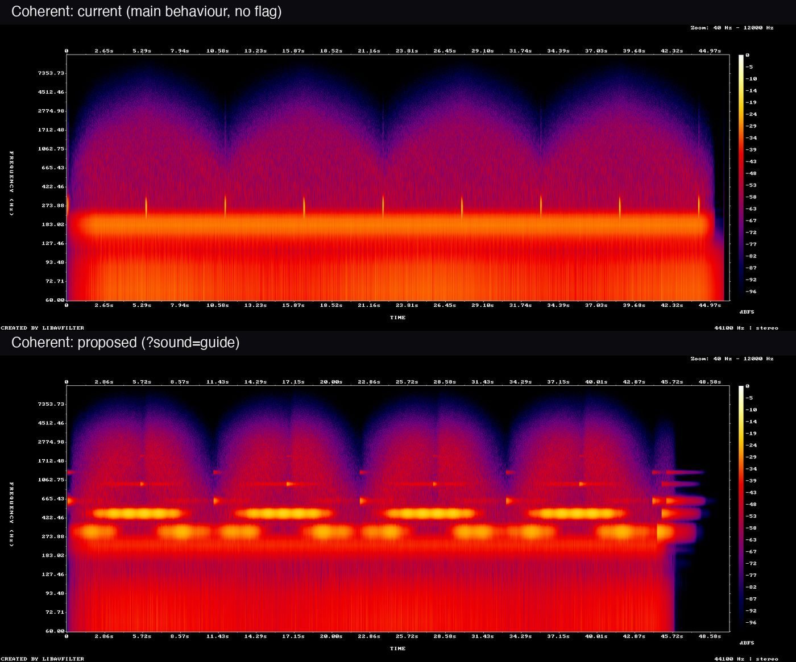

# Sound design, November 2026: the sound guide

Status: prototype on branch `t3/eyes-closed-sound-design`, web only, behind `?sound=guide`. Default off. Not shipped.

## Summary

Today a session marks each phase with a 0.3 s blip at its start. Between two blips the sound does not change. A person with closed eyes cannot tell an inhale from an exhale, or how much of the phase is left. Denise asked for exactly this on 2026-10-24: an inhale and exhale tone in Coherent Breathing, so she does not have to watch the screen.

The proposal is one new layer, the **sound guide**: a soft voice that plays for the whole phase and moves the way the breath moves. It rises, brightens and swells on the inhale. It holds still on a hold. It falls, darkens and fades on the exhale. It is synthesized in the shared engine (`packages/audio`), so the same code can run on iOS. It uses no audio files and no paid service.

Try it: open `/breathe/coherent?sound=guide` on the branch. Add `&bed=0` to hear the guide without the ambient bed.

## What exists

Web and iOS share one engine, `packages/audio/src/audioService.ts`. The web app drives it from `src/components/resonance/Resonance.tsx`. The iOS app runs the same engine on `react-native-audio-api` through `apps/mobile/src/breathing/native-soundscape.ts`; the webview stays the timing authority and sends `phase_haptic`, `audio_state` and completion events to the native shell.

| Moment | What plays today |
|---|---|
| Session start | Beds fade in over 2 to 3 s. The first inhale cue plays. No start sound. |
| Inhale | A 0.24 to 0.38 s cue: a tone that glides up (Box 520 to 660 Hz) plus a noise puff. |
| Second inhale (Physiological Sigh) | The same inhale cue again. |
| Hold, full or empty | A 0.22 to 0.26 s flat tone. Both holds use the same cue. |
| Exhale | A 0.30 to 0.42 s cue: a tone that glides down plus a noise puff. |
| Between cues | Drone modes: nothing that follows the breath. 4-7-8 and Coherent: the noise bed's filter opens and closes (480 to 2400 Hz). |
| Session end, web | Beds fade out over 1 to 1.5 s. No completion sound. |
| Session end, iOS | The same fade, then a two-note completion bloom (`playCompletionCue`). |
| Beds | Box, Sigh, Ujjayi, Belly, Pursed Lip: a four-partial drone that orbits the listener, a sub-bass and a 10 Hz binaural pair. 4-7-8 and Coherent: pink noise, a sub-bass and a binaural pair (2 Hz and 10 Hz). |
| Cue presets | Box, 4-7-8 and Coherent have their own. Sigh, Ujjayi, Belly and Pursed Lip share one default set. |

Settings and platform behaviour:

- **Mute.** Settings has one "Sound on / Sound off" button. It ramps the master gain to 0 in 0.1 s. The choice is not saved. iOS mirrors it through `audio_state.muted`.
- **Volume.** There is no user control. The engine uses fixed defaults (cue 0.32, music 0.3).
- **Binaural beats.** A Settings switch, on by default, saved, and mirrored to iOS.
- **Eyes closed.** `?eyesClosed=1` dims the visuals and adds one sine tone that swells on the inhale and decays on the exhale. The Settings switch is parked: a code comment says the feature needs voice narration in each locale to be useful.
- **iOS app.** The audio session category is `playback`. Sound plays with the ringer switch off and continues on the lock screen. The native chain has no compressor (a soft clipper stands in) and no 3D panner (a stereo panner stands in).
- **iOS Safari.** Web Audio follows the ringer switch, so a silenced phone plays nothing. The web app shows a hint for this.

## What is wrong with it

Measured on `main` at `9339d55` with `scripts/audio-lab` (real engine, real page, headless Chromium).

1. **A phase is marked only at its start.** A Coherent phase lasts 5.5 s; its cue lasts 0.34 s. In the drone modes nothing follows the breath for the rest of the phase. In Coherent and 4-7-8 only the noise bed's filter does, and that bed is the quietest layer: the level moves by 1.7 dB across an inhale.
2. **Inhale and exhale are nearly the same cue.** In Coherent both start at 294 Hz. One glides up two semitones, the other down two semitones, in a third of a second.
3. **Holds and the double inhale are not told apart.** A full-lungs hold and an empty-lungs hold play the same cue. The two inhales of the Physiological Sigh play the same cue.
4. **Loudness jumps 10 dB between modes.** Box measures -15.3 LUFS and Sigh -15.0 LUFS. Coherent measures -25.7 LUFS.
5. **The loudest steady sound in Coherent is the binaural carrier.** The fixed 200 Hz pair measures -29 dBFS. The noise bed, the one layer that follows the breath, measures -43 dBFS. The carrier is also out of key: Box's drone has a partial at 196.2 Hz, 3.8 Hz below it.
6. **Cues are not in the drone's key.** Cue pitches are fixed in Hz. The drone root moves with the mode, and the session arc lowers it by a whole tone over four minutes. The engine's own comments note this.
7. **Every session ends on a hard cut.** The sub-bass has an LFO that adds to its gain. The fade ramps the gain to 0, but the LFO swing keeps sounding until the oscillator stops. The result is a step of -53 to -66 dBFS into silence, about 1.6 s after each stop. It appears in five of the six baseline recordings. The step is small and may be inaudible on its own. The drone is built the same way; its stop sits behind a lowpass, so the tooling cannot measure it.
8. **The web app has no start or completion sound.** The completion bloom exists, but only iOS calls it.
9. **Mute is not saved, and there is no volume control.**

One item outside sound: CI does not run `packages/audio/src/audioService.test.ts`. The mobile job runs vitest inside `apps/mobile` only.

## Lessons from the earlier work

- **Audio V2** (`audio-v2-overnight`, merged through PR #21) added texture: the sub-bass, the breathing noise bed and the session arc. Texture made the sound richer. It did not make a phase easier to read. Its hiss came from triangle harmonics and the 3D panner, and a drone lowpass fixed it. The lesson: keep every new layer below about 3 kHz and measure the top band.
- **DAR-379** (`abi/dar-379-audio-eyes-closed-audio-only-mode`, one unmerged commit) joined two things: a dimmed screen and one swelling sine. The sine freezes during holds and has no edges, so it cannot say "hold" or "now". The feature was parked for narration, which costs a recording per locale. The lesson: make the sound readable without words, and keep it separate from any change to the visuals.
- **react-native-audio-api** renders repeated `setTargetAtTime` calls as an audible warble (recorded in the engine on 2026-07-22). The lesson: schedule each phase once, with linear ramps only.
- **The V2 experiment entry** named three metrics and never reached a verdict. The lesson: one primary metric.

## The proposal

### One grammar for every mode

The guide has three parts: a tone, an air layer and a marker.

- **Tone.** Three notes of the mode's key: root, fifth and octave. The notes are sines with a quiet octave partial. They sit between 247 and 988 Hz, where a phone speaker can play them.
- **Air.** Band-passed noise, low-passed at 3.2 kHz. It sounds only while air moves.
- **Marker.** One soft chime at the start of each phase, an octave above the note the voice is on.

| Phase | Tone | Level | Air | Marker |
|---|---|---|---|---|
| Inhale | Crossfades from root to fifth | Swells from rest to full | Swells, band moves up | Chime on the root |
| Second inhale | Crossfades from fifth to octave | Short dip, then a second swell | Second swell | Chime on the fifth |
| Hold, full | Stays on the note it reached | Settles to about two thirds, sways slowly | Fades out | Soft chime, same note |
| Exhale | Crossfades down to the root | Small lift, then a long fall | One release, band moves down | Chime on the note it leaves |
| Hold, empty | Stays on the root | Near rest | None | Soft chime on the root |

A listener needs three rules. A moving sound means breathe; a still sound means hold. Up, brighter and louder mean in; down, darker and softer mean out. High and present mean full; low and quiet mean empty.

Session edges:

- **Start.** The beds fade in over 2 to 3 s and the voice over 0.5 s. The first chime marks the first inhale.
- **Completed session.** The voice fades over 1.6 s. A root, fifth and octave chord enters one note at a time and rings for about 4 s. The chord resolves; it is not a notification sound.
- **Pause or stop.** The voice fades in 0.5 s. No chord plays.

### One articulation per mode

Every mode uses the same instrument. A mode changes only what its technique asks for.

| Mode | Key on the mode's own page (ladder notes) | What changes |
|---|---|---|
| Box | C (262, 392, 523 Hz) | Clear tone, little air. Four equal sides: rise, still, fall, still. |
| 4-7-8 | D (294, 440, 587 Hz) | A quieter 7 s hold. The 8 s exhale has the most air, like a mouth exhale. |
| Coherent | E (330, 494, 659 Hz) | No holds. One continuous wave with moderate air. |
| Physiological Sigh | F (349, 524, 698 Hz) | Two rising steps for the two inhales, then one long fall with strong air. |
| Ujjayi | C | Air leads and the tone stays behind it. A narrow band gives the throat sound. |
| Belly | C | Darker tone (lowpass 520 to 1400 Hz), almost no air. |
| Pursed Lip | E | A short soft inhale. The exhale is a thin, narrow stream. |

The other web modes use the base profile. Wim Hof keeps the legacy cues in this prototype, because its phases are not fixed in length.

### The ambient bed is optional and sits under the voice

With the guide on, the beds keep their per-mode recipe at a lower gain: drone ×0.22, sub-bass ×0.5, noise ×0.9, binaural ×0.45. All seven modes then land within a few dB of each other. The binaural carrier moves to the fifth of the mode's root, so it is in key. The drone holds its root while the guide plays. `&bed=0` removes the bed.

### Mute, volume and the silent switch

- The guide connects to the engine's master gain. Mute silences it the same way as every other layer, and unmute restores it at once.
- The guide scales with the engine's cue volume, so one future "guide volume" control needs no new audio code.
- On the iOS app the guide inherits the `playback` session: it plays with the ringer off and on the lock screen, like today's sound. That fits a session the user starts on purpose, and the in-app mute still works.
- On iOS Safari the ringer switch still silences everything. See the plan below.

## The prototype

| File | Role |
|---|---|
| `packages/audio/src/soundGuide.ts` | The guide. `planGuidePhase` is pure and holds the whole palette. `SoundGuide` schedules a plan on the audio clock. |
| `packages/audio/src/audioService.ts` | `startSoundGuide`, `playGuidePhase`, `stopSoundGuide`, the bed gains under the guide, the in-key binaural carrier. |
| `src/components/resonance/Resonance.tsx` | Reads `?sound=guide` and `&bed=0`. Calls the guide at each phase start in place of `playCue`. |
| `scripts/audio-lab/` | Records and measures real sessions. |

Each phase is scheduled once, at its start, from its known length. Nothing runs per frame. The schedule uses `setValueAtTime` and `linearRampToValueAtTime` only. Each phase ends its curves 70 ms early and starts 30 ms ahead of the clock, so the next phase finds every parameter at rest.

Without `?sound=guide` no guide code runs. The session start and end events gain a `sound: "guide"` parameter only when the flag is on.

Two fixes apply only under the guide, so production is unchanged: the LFO depth of the drone and the sub-bass fades with the bed (finding 7), and the binaural carrier is in key (finding 5). Both are worth applying to the legacy mix too. That needs Abi's decision.

## Evidence

All clips come from the real page and the real engine on this branch, in headless Chromium at 44.1 kHz. "Current" has no flag. "Proposed" has `?sound=guide`. Each clip starts at the Start Session click and runs past the session end.

| Where | What |
|---|---|
| [`docs/evidence/sound-guide-2026-11-14/`](../evidence/sound-guide-2026-11-14/) | The six core clips (M4A), three spectrogram sheets, and a screen recording with sound. |
| `/Users/abi/.t3/userdata/attachments/dbe-sound-2026-11-14/` on the machine that ran this | All eleven clips (WAV and M4A), every spectrogram, `measurements.json`, and the screen recording at full size. |

Listen in this order:

1. Coherent: [current](../evidence/sound-guide-2026-11-14/coherent-current.m4a), then [proposed](../evidence/sound-guide-2026-11-14/coherent-proposed.m4a).
2. Box: [current](../evidence/sound-guide-2026-11-14/box-current.m4a), then [proposed](../evidence/sound-guide-2026-11-14/box-proposed.m4a).
3. Physiological Sigh: [current](../evidence/sound-guide-2026-11-14/sigh-current.m4a), then [proposed](../evidence/sound-guide-2026-11-14/sigh-proposed.m4a).
4. [One Coherent session, screen and sound](../evidence/sound-guide-2026-11-14/coherent-session-with-sound.mp4).

In the lower picture the two bright rows are the root (330 Hz) and the fifth (494 Hz). The sound moves up through each inhale and down through each exhale. The short marks above them are the chimes. The chord at the right is the session end. In the upper picture the only bright row is the 200 Hz binaural carrier, and the cues are thin vertical marks. The other sheets: [Box](../evidence/sound-guide-2026-11-14/box-current-vs-proposed.jpg), [Physiological Sigh](../evidence/sound-guide-2026-11-14/sigh-current-vs-proposed.jpg).

### Measurements

| Clip | Length | Loudness | True peak | Clipped samples | Steps | 6 to 20 kHz | Inhale | Exhale |
|---|---:|---:|---:|---:|---:|---:|---:|---:|
| Coherent, current | 46 s | -25.7 LUFS | -9.8 dBTP | 0 | 1 | -76 dBFS | +1.7 dB | -1.9 dB |
| Coherent, proposed | 50 s | -19.5 LUFS | -10.2 dBTP | 0 | 0 | -70 dBFS | +7.3 dB | -10.2 dB |
| Box, current | 50 s | -15.2 LUFS | -4.4 dBTP | 0 | 6 | -106 dBFS | +4.0 dB | +8.9 dB |
| Box, proposed | 54 s | -20.5 LUFS | -9.0 dBTP | 0 | 0 | -81 dBFS | +6.5 dB | -10.2 dB |
| Physiological Sigh, current | 46 s | -15.0 LUFS | -3.9 dBTP | 0 | 9 | -105 dBFS | +0.1 dB | +0.5 dB |
| Physiological Sigh, proposed | 50 s | -19.9 LUFS | -9.5 dBTP | 0 | 0 | -70 dBFS | +5.3 dB | -9.7 dB |
| 4-7-8, proposed | 44 s | -20.4 LUFS | -11.4 dBTP | 0 | 0 | -70 dBFS | +6.7 dB | -9.7 dB |
| Ujjayi, proposed | 36 s | -19.9 LUFS | -7.4 dBTP | 0 | 0 | -75 dBFS | +5.3 dB | -9.5 dB |
| Belly, proposed | 36 s | -19.6 LUFS | -8.6 dBTP | 0 | 0 | -82 dBFS | +6.1 dB | -9.6 dB |
| Pursed Lip, proposed | 36 s | -19.1 LUFS | -7.4 dBTP | 0 | 0 | -76 dBFS | +4.5 dB | -10.0 dB |
| Coherent, proposed, no bed | 28 s | -19.8 LUFS | -11.9 dBTP | 0 | 0 | -70 dBFS | +7.3 dB | -10.9 dB |

How to read the table:

- **Loudness** is integrated EBU R128. The seven proposed modes span 1.4 dB (-20.5 to -19.1 LUFS). The three current modes span 10.7 dB.
- **Clipping.** No clip has a sample at full scale. The highest true peak is -7.4 dBTP in the proposed clips and -3.9 dBTP in the current ones.
- **Steps** are sharp discontinuities in the waveform. The proposed clips have none. Current Coherent has the end cut (-53 dBFS). Current Box has six steps of about -77 dBFS, one at the start of each hold cue. Current Sigh has eight steps of -72 to -77 dBFS and the end cut (-66 dBFS). The detector was checked by injecting faults; see [`scripts/audio-lab/README.md`](../../scripts/audio-lab/README.md). It cannot see a tick that sits behind a lowpass.
- **6 to 20 kHz** is the hiss band. Every proposed clip stays at or below -70 dBFS there. The air layer does raise this band: by 6 dB over today's Coherent, and by about 25 dB over today's Box, which has almost nothing there. Judge the air by ear.
- **Inhale and Exhale** give the change in level from the first third to the last third of a phase, between 250 Hz and 4 kHz, after the first 0.45 s. In all seven proposed modes the average inhale rises (+4.5 to +7.3 dB) and the average exhale falls (-9.5 to -10.2 dB). Current Coherent moves by under 2 dB. Current Box and Sigh have no fixed direction; the +8.9 dB on Box's exhale is the drone's own slow drift.

Three checks beside the table:

- **The flag-off path is unchanged.** The current clips from this branch match clips recorded from `main` at `9339d55` before any change: Box -15.2 against -15.3 LUFS, Coherent -25.7 against -25.7, Sigh -15.0 against -15.0.
- **Mute and pause work under the guide.** In a Box session with the guide on, the sound button in Settings took the output from -23 dBFS to -134 dBFS within a second. A second press brought it back to -22 dBFS. Pause reached silence in about 2 s. No step was found.
- **The screen recording is in sync.** At four phase starts the chime is within 55 ms of the text change on screen. The video comes from the browser's screen recorder and the sound from the audio tap; they were joined at the Start click.

To record and measure again, follow [`scripts/audio-lab/README.md`](../../scripts/audio-lab/README.md).

## Implementation plan

### Web, about 3 to 4 days

| Step | Effort |
|---|---|
| Listening pass with Abi; adjust `MODE_PROFILES` | 0.5 day |
| A "Breath sound" setting that replaces the parked eyes-closed switch; saved; phrases for all locales | 1 day |
| Save mute; add one guide volume and one ambience volume control | 0.5 to 1 day |
| Wim Hof phases; re-plan the current phase when the speed slider moves | 0.5 day |
| Apply the end-cut fix and the in-key carrier to the legacy mix | 0.25 day |
| Register `sound` as a GA4 event dimension; add a `muted` parameter to the session events | 0.25 day |
| iOS Safari: set `navigator.audioSession.type = "playback"` where it exists, then test on a phone | 0.25 day |
| Document `sound=guide` in the embed generator | 0.25 day |

### iOS, about 2 to 3 days; plan only

No iOS code is in this branch. The engine part is already shared, but the result cannot be judged without a device, and `react-native-audio-api` has rendered Web Audio schedules wrongly before.

| Step | Effort |
|---|---|
| `native-soundscape.ts`: start the guide before the beds; on `phase_haptic` call `playGuidePhase` with `phaseDurationSeconds`; on completion call `stopSoundGuide({ closing: true })` in place of the bloom | 0.5 day |
| Mirror the setting from `resonance_settings`, the way `binauralEnabled` is mirrored | 0.25 day |
| Device checks: ramp density (up to 48 ramps per parameter per phase), `cancelAndHoldAtTime`, the 2.2 s reverb, ten oscillators plus looped noise, levels through the soft clipper | 1 day |
| TestFlight pass: ringer off, lock screen, Bluetooth delay | 0.5 day |
| Fallback if the device renders the schedule wrongly: render one breath cycle with `OfflineAudioContext` at session start and loop the buffer | 1 to 1.5 days, only if needed |

Rendered audio files (`expo-audio`) are not proposed. The speed slider is continuous, so no fixed set of files can follow the phase length.

## Decisions for Abi

1. Is the voice right? Listen to the Coherent pair first. If the air reads as hiss, it can drop per mode without touching the tone.
2. Setting or default? A Settings switch will reach few people: 15 of 799 session starters touched the binaural switch in 28 days. A default for a share of sessions measures faster.
3. Loudness. Under the guide, Box and Sigh are about 5 dB quieter than today and Coherent about 6 dB louder. Every mode lands near -20 LUFS.
4. Apply the end-cut fix and the in-key carrier to today's mix?

## Not verified

- No person has listened to these clips. The checks are measurements: peaks, loudness, clipping, steps, band levels and spectrograms.
- Nothing was tested on a phone, on Safari or on Firefox. The clips come from headless Chromium on macOS.
- The iOS plan is untested.
- Wim Hof and a speed change in the middle of a phase are not covered by the guide.
